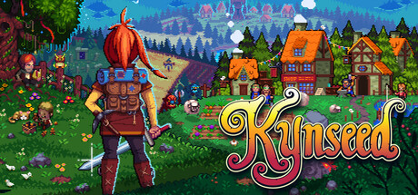

**Kynseed is the charming life and legacy simulation where you tend a magical farm, run a shop, explore a fairy-tale world, and pass your character's spirit to your children when they die, continuing the family's story across generations.**

---

## 📖 About

Kynseed is the charming life and legacy simulation where you tend a magical farm, run a shop, explore a fairy-tale world, and pass your character's spirit to your children when they die, continuing the family's story across generations.

## ⚠️ Problems Without Trainer

| Problem | Status |
|---------|--------|
| **Death and Inheritance** — Losing accumulated knowledge and skills on character death requires adjustment | ✅ Solved |
| **NPC Aging** — Beloved characters age and die over generations creating emotional attachment | ✅ Solved |
| **Trade Route Building** — Establishing profitable shop trade requires understanding supply and demand | ✅ Solved |
| **Seed Planting Timing** — Seasonal farming windows are strict and easily missed by new players | ✅ Solved |

## ✅ Solution

The **Kynseed Trainer** solves all these issues by giving you complete control over the game.

## 🎯 Full Feature List

- Unlimited Resources
- God Mode / Invincibility
- Instant Skill Cooldown
- One-Hit Kill
- Freeze Game Timer
- Unlock All Items & Achievements
- Custom Speed Multiplier
- Save State Anywhere

## 🚀 Quick Start

1. **Disable Windows Defender** temporarily (trainer may trigger false positive)
2. Download the trainer from the button above
3. Launch Kynseed
4. Run the trainer as Administrator
5. Activate desired cheats with hotkeys

## 💎 Free vs Paid

| Feature | Free | Pro |
|---------|------|-----|
| Basic God Mode | ✅ | ✅ |
| Unlimited Resources | ✅ | ✅ |
| All Advanced Cheats | ❌ | ✅ |
| Auto-Updates | ❌ | ✅ |
| Priority Support | ❌ | ✅ |

## 💻 Requirements

- Windows 10/11 (64-bit)
- Kynseed (any version)
- .NET Framework 4.8+
- DirectX 11+

## 🍎 macOS

macOS users can use our alternative tool:

## ⚖️ Legal

This trainer is for educational and single-player use only. Use responsibly.

---

